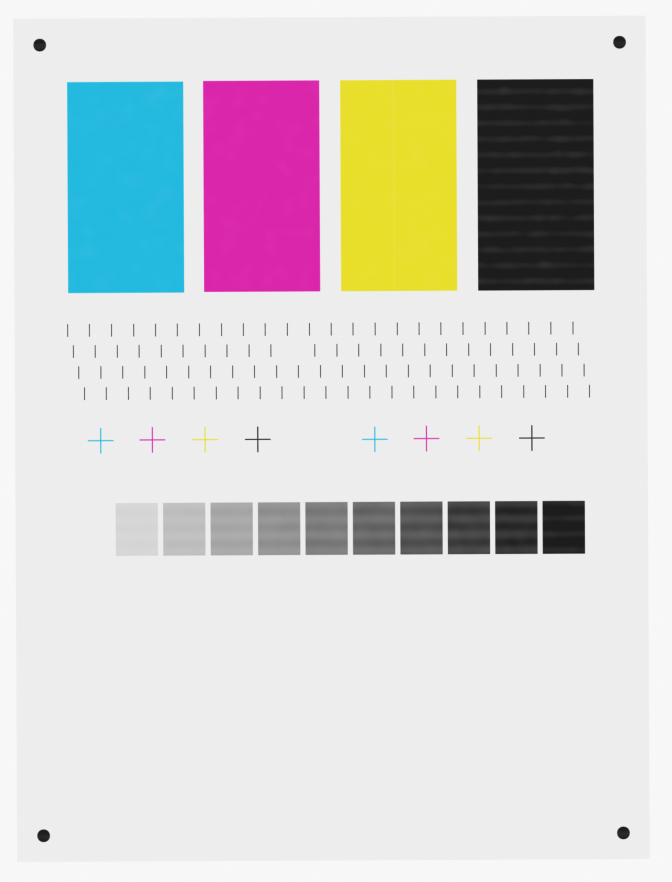
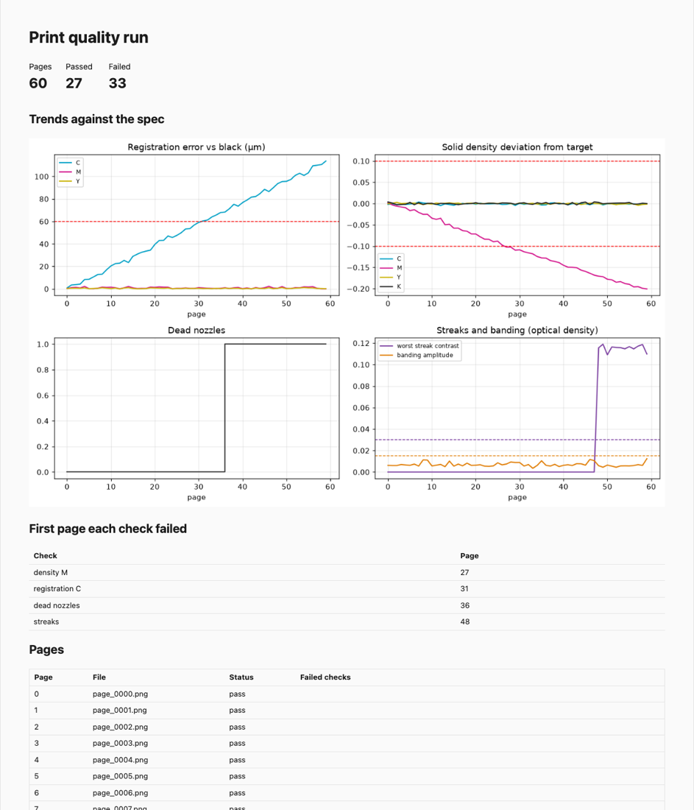

# printqa — Automated Print-Quality Inspection

A tool for a print product-test team. Scan a printed test chart, and printqa finds the chart in the scan, measures
streaks, banding, dead nozzles, color registration, density and tone, checks each against a spec, and writes a
CSV, JSON and an HTML report. The report has trend charts across the run and the first page each check failed.
A built-in print-and-scan simulator injects defects with known answers, so the inspector's own accuracy is measured,
not assumed.

Python, OpenCV, NumPy, Matplotlib.

 

## How well it works

`bench/validate.py`: 530 simulated scans, each with random scanner rotation, scale, shift, blur and noise, plus
realistic ink mottle; results in `results/validation.json`.

| Check | Result |
|---|---|
| **False alarms** | **0 of 110 defect-free pages failed any check** |
| Dead nozzles (1–4 of 96, 60 pages) | 60 / 60 pages exactly right: 150 found, 0 false, 0 missed |
| Color registration (240 measurements) | **0.9 µm RMSE**, 3.4 µm worst case, with 85 µm scanner pixels; pass/fail at the 60 µm limit agreed with the truth 237 / 240 times, and all 3 disagreements were within 0.4 µm of the limit |
| Streaks: ink loss 0.5% / 1% / 2% / 4% / 8% | reported on 0 / 0 / 24 / 30 / 30 of 30 pages; located to about 0.2 mm |
| Banding: amplitude 0.005 / 0.01 / 0.02 / 0.04 | flagged on 0 / 4 / 30 / 30 of 30 pages; period within about 6% |
| Speed | 0.5 s per page on one core; 60 pages inspected in about 5 s on 4 |

The misses at the low end are the detector's sensitivity limit, not a malfunction. A 2% ink loss produces a streak
of about 0.03 optical density, the size of normal ink mottle and right at the spec limit, so it is reported 80% of
the time and fails the spec half the time.

**A simulated press run** (`printqa simulate-run`, 60 pages) degrades on purpose: cyan registration drifts, magenta
ink starves, nozzle 41 dies on page 36, and a yellow streak appears on page 48. The report flags:
- the dead nozzle on page 36, naming nozzle 41
- the streak on page 48, at 91.36 mm (true position 91.44 mm)
- cyan registration on page 31; it truly crosses 60 µm on page 32, and page 31 measures 59.7 µm, one micrometer
  away
- magenta density on page 27

## How it measures

1. **Find the chart.** Four corner dots are located by connected components with sub-pixel centroids. A perspective
   warp maps the scan back onto chart coordinates, undoing rotation, scale and offset.
2. **Optical density.** Measurements use D = −log10 of reflectance relative to the paper, the unit print quality is
   specified in. Cyan is read in the red channel, magenta in green, yellow in blue, and black in all three.
3. **Checks:**
   - **Density:** mean of each solid patch, against targets calibrated from known-good pages.
   - **Streaks:** column profile of each solid minus a running median, flagged above both the spec and 6 robust
     standard deviations.
   - **Banding:** the strongest periodic component of the row profile, using a Hann-windowed FFT.
   - **Nozzles:** each nozzle line is present or missing, judged against the median line strength.
   - **Registration:** the center of each color's cross relative to black's, in micrometers.
   - **Tone:** an 11-step ramp and the tone value increase at 50% (Murray–Davies).

**The registration bug the validation caught.** The first version found each cross's center as the centroid of a
thresholded shape. On a perfectly registered page it reported up to 400 µm of error. A residual tilt of a fraction
of a degree after alignment left a few edge rows of each line straddling the threshold on one side, which dragged
the centroid by several pixels. The fix measures each arm's cross-section profile and takes the profile's
centroid. Averaging along the arm also cancels ink mottle, which had biased an ink-weighted centroid. Error fell
from hundreds of micrometers to under one.

## Use it

```bash
uv sync
uv run printqa simulate-run --pages 60 --out scans/                    # or use real scans of the chart
uv run printqa calibrate scans/page_0000.png scans/page_0001.png --out spec.yaml   # targets from known-good pages
uv run printqa inspect scans/page_*.png --spec spec.yaml --out report/  # CSV, JSON, report.html; exit 1 if any page fails
uv run python bench/validate.py                                        # accuracy against ground truth
uv run pytest                                                          # 11 tests
```

Limits live in the spec YAML: density tolerance, streak and banding amplitude, dead nozzles allowed, registration
in micrometers, and the tone value increase range.

## Limitations

- **Simulated scans only.** The press and scanner models are physically motivated (dot gain, per-channel
  absorption, mottle, blur, noise, geometry), but real scanners add lamp non-uniformity, paper texture and color
  response that would need calibration. The validation numbers are an upper bound until checked against scans of a
  real press.
- **The chart layout is fixed.** A production version would read the layout from a file per test target.
- **One spec per run.** Tolerances per paper or media type would be the next step.

## License and AI disclosure

MIT (see `LICENSE`). Built with help from Claude (Anthropic) via Claude Code; I reviewed, tested and verified the
code and results.
